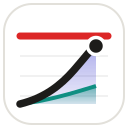
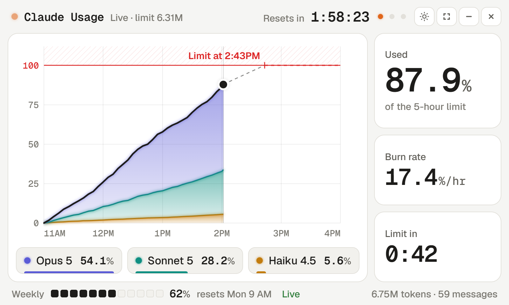
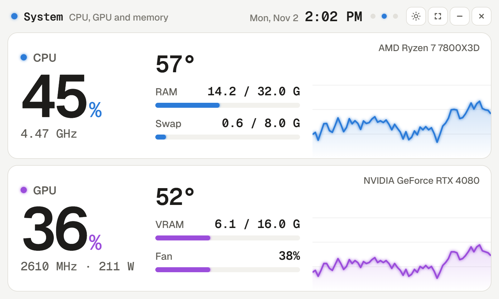
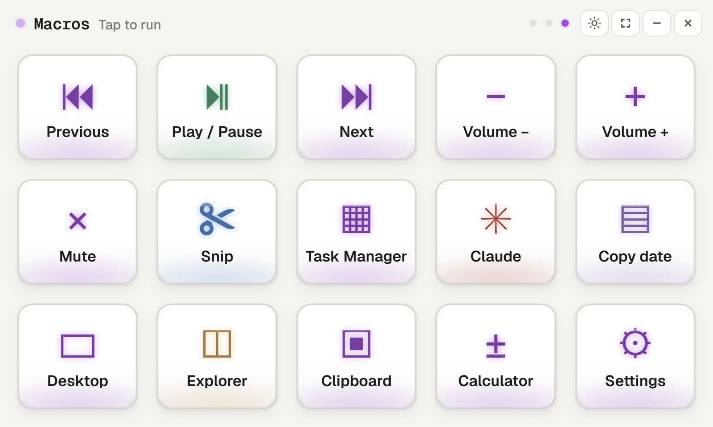
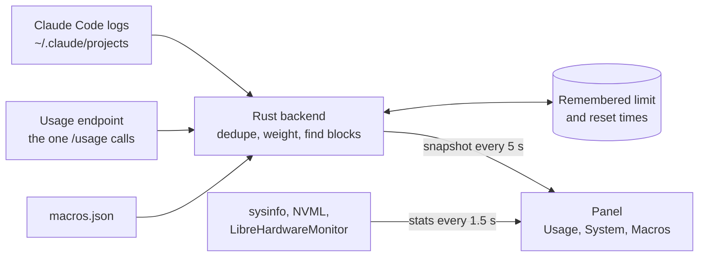

<div align="center">

<picture>
  <source media="(prefers-color-scheme: dark)" srcset="docs/img/logo-dark.svg">
  
</picture>

# Claude Usage

### Your Claude limit, on a screen of its own.

A desk panel for a 5-inch, 800×480 touch display. It shows how much of your current 5-hour block is gone and whether you'll hit the limit before it resets, next to your PC's vitals and a page of Stream Deck style buttons. No API keys and no setup: it reads what Claude Code already keeps on your machine, and it keeps working with the network off.


[Three pages](#three-pages-one-swipe-apart) · [How it works](#how-it-works) · [Run it](#run-it-yourself) · [Macros](#set-up-your-macros) · [Under the hood](docs/how-it-works.md)

<picture>
  <source media="(prefers-color-scheme: dark)" srcset="docs/img/usage-dark.png">
  
</picture>

</div>

## At a glance

<table>
<tr>
<td align="center" width="33%"><h1>5 hours</h1>A block starts at your first message and resets five hours later, not on the hour. The panel charts the whole block, start to reset.</td>
<td align="center" width="33%"><h1>0 API keys</h1>Nothing to paste in and nothing to calibrate. It reads Claude Code's own logs and the same endpoint <code>/usage</code> asks.</td>
<td align="center" width="33%"><h1>14 px</h1>The smallest text on screen. Every page is built to be read from a few feet away.</td>
</tr>
</table>

## Three pages, one swipe apart

**Usage** (above) charts the current block, stacked by model. The bold line is the total, the dashed line is where your burn rate lands you, and the red line is the limit. If you're on pace to hit it, the chart marks the time. Tap a model to lift it out of the stack.

<table>
<tr>
<td width="50%"><picture><source media="(prefers-color-scheme: dark)" srcset="docs/img/system-dark.png"></picture></td>
<td width="50%"><picture><source media="(prefers-color-scheme: dark)" srcset="docs/img/macros-dark.png"></picture></td>
</tr>
<tr>
<td><b>System.</b> CPU and GPU load, clocks, temperatures, memory, VRAM and fan, sampled every 1.5 seconds, with a live graph for each.</td>
<td><b>Macros.</b> Glass keys over a lit screen, like a Stream Deck. Each one plays media, sends a shortcut, opens an app, or runs PowerShell, all from one JSON file.</td>
</tr>
</table>

The button in the header cycles dark, light, and system, which follows Windows and is where it starts. The screenshots here follow your GitHub theme.

## How it works

1. **Read.** Claude Code logs every exchange under `~/.claude/projects/`. The panel reads only what's new on each poll, drops the duplicate records that resumed sessions write (about half of them), and weights tokens by price, because limits track compute, not volume.
2. **Ask.** It calls the endpoint Claude Code's `/usage` uses, with Claude Code's own login, read-only. That gives the true percentage and reset time, and dividing tokens by the percentage solves for your plan's limit.
3. **Remember.** The last real limit and reset times are saved. Offline, the panel keeps using them instead of guessing, and the header says which source is in play: Live, Remembered, or Estimated.
4. **Draw.** One block, start to reset: the pen sits at now, and the space to its right is the time you have left.



The details, including how 100% is solved for and what the app is allowed to touch, are in **[How it works](docs/how-it-works.md)**.

## Run it yourself

To install it, download the latest installer from [Releases](https://github.com/xanderscannell/claude-usage/releases). To build it, you need Windows, [Node.js](https://nodejs.org), [Rust](https://rustup.rs), and Claude Code signed in on the same machine.

```bash
git clone https://github.com/xanderscannell/claude-usage.git
cd claude-usage
npm install
npm run tauri dev     # the panel
npm run dev           # frontend only, on synthetic data
npm run tauri build -- --no-bundle   # standalone exe; plain cargo builds load the dev server
cd src-tauri && cargo test
```

Optional extras for the System page:

- **GPU readouts** need an NVIDIA card. Without one, the GPU card hides.
- **CPU temperature** needs [LibreHardwareMonitor](https://github.com/LibreHardwareMonitor/LibreHardwareMonitor) running, so the panel itself never needs admin. Set it up once: run it (it asks for admin to load its driver), turn on Options → Remote Web Server → Run on the default port 8085, and Options → Run On Windows Startup. Without it the temperature hides.

## Set up your macros

The buttons come from `macros.json` in `%APPDATA%\dev.xander.claude-usage`, written with a starter set on first run. Saving the file updates the page within two seconds. A mistake shows on the button it belongs to, or in place of the grid if the file will not parse.

```json
{
  "columns": 5,
  "buttons": [
    { "label": "Play / Pause", "icon": "⏯", "color": "#55A87A", "media": "play_pause" },
    { "label": "Mute Discord", "keys": "ctrl+shift+m" },
    { "label": "Spotify", "open": "spotify:" },
    { "label": "OBS", "open": "C:\\Program Files\\obs-studio\\bin\\64bit\\obs64.exe", "args": "--minimize-to-tray" },
    { "label": "Headphones", "run": "Set-AudioDevice -Index 2" }
  ]
}
```

Each button has a `label`, an optional `icon` (any text; symbols such as ⏯ ✂ ▦ render in the button's colour) and `color`, and exactly one action:

| Action | What it does |
| --- | --- |
| `media` | `play_pause`, `next`, `previous`, `stop`, `volume_up`, `volume_down`, `mute` |
| `keys` | a combo such as `ctrl+shift+m`: `ctrl` `shift` `alt` `win`, letters, digits, `f1`-`f24`, `enter` `esc` `tab` `space` `backspace` `delete` `insert` `home` `end` `pageup` `pagedown` `up` `down` `left` `right` `printscreen` `plus` `minus` |
| `open` | a program, file, folder or URL, as if double-clicked; `args` passes arguments to a program |
| `run` | a PowerShell command, run hidden |

Backslashes in paths are doubled, as JSON requires. `Set-AudioDevice` above comes from the `AudioDeviceCmdlets` module (`Install-Module AudioDeviceCmdlets`).

The window cannot take focus, so a tap leaves keyboard focus with the app you were using and `keys` lands there. It also means the arrow keys don't turn pages; swipe instead. Windows will not let the panel type into an app running as administrator unless the panel runs as administrator too.

The page only ever sends a button's position and label. The action is read from the file on the Rust side, so nothing in the webview can name a command to run.

## Credits

- Type is [Geist and Geist Mono](https://vercel.com/font), bundled under the SIL Open Font License.
- CPU temperature comes from [LibreHardwareMonitor](https://github.com/LibreHardwareMonitor/LibreHardwareMonitor).
- An unofficial tool, not made by or affiliated with Anthropic.
